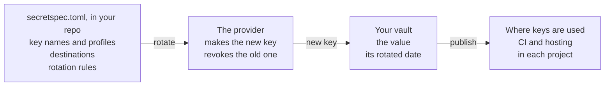

# How it works

When a key changes, keypin follows it from the provider that issues it, to your vault, to every place that uses
it. The project's `secretspec.toml` says which keys exist and where each one lives; keypin's part of it says where
each key goes and how it's rotated.



## Rotation

Give a key an `issuer`, such as Resend, Neon or OpenAI, and `keypin rotate` creates a new key at the provider,
saves it to your vault and publishes it to every destination in `secretspec.toml`. Its plan says whether keypin
revokes the old key after a second `y`, or leaves it for you to delete, as on a first Resend rotation. See
[Rotating a key](../guides/rotating-a-key.md).

`keypin status` shows which keys are due, in every project. [Scheduled rotation](../guides/scheduled-rotation.md)
rotates them in your GitHub Actions.

## Your vault holds the values

Each value is kept once, in your vault. keypin reads it only while `publish` or `rotate` needs it. A rotated date on
the secret tells keypin when the key is due.

## secretspec.toml holds names and places

[secretspec](https://secretspec.dev) owns the file: the project's keys and the vault each one lives in. keypin adds
`[tool.keypin]`: where each key goes and how it's rotated. The file holds no value, so you commit it.

```toml
[project]
name = "billing"
revision = "1.0"

[providers]
acme = "onepassword://Acme"

[defaults]
providers = ["acme"]

[profiles.default]
STRIPE_KEY = { description = "Stripe test key" }

[profiles.production]
STRIPE_KEY = { description = "Stripe live key" }

[tool.keypin.production.STRIPE_KEY]
rotate_every = "90d"
publish = [{ to = "github-actions", repo = "me/billing" }]
```

Here `STRIPE_KEY` has one 1Password item per profile in the `Acme` vault, `secretspec/billing/default/STRIPE_KEY`
and `secretspec/billing/production/STRIPE_KEY`, and the production value is published to the GitHub repo
`me/billing`. keypin rejects a field it doesn't know and a `<...>` left in a value. Every field keypin reads is in
[secretspec.toml](../reference/secretspec-toml.md).

## Profiles

Each secretspec profile is a set of keys, such as `default` for your laptop and `production`. Every profile also has
the keys of `[profiles.default]`. `keypin publish` and `keypin rotate` use `production`; `--profile <name>` picks
another. Each profile reads its own vault item, so your laptop never needs the production value.

## How a key reaches your code

- `secretspec run -- <command>` starts your command with the keys as environment variables, on your laptop or in a
  CI job.
- `keypin publish` writes each value to its destinations, such as a GitHub Actions secret or a Cloudflare Worker.

## keypin asks first

`publish` and `rotate` show a plan with the account they reached at each destination. A first write, a changed
account or a changed vault item waits for your `y`. keypin never deletes a copy it published, and keeps no value on your machine
([Files and state](../reference/files-and-state.md)).
