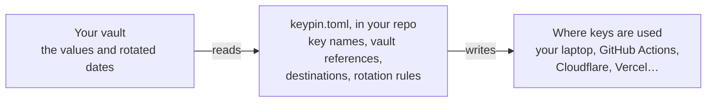

# How it works

keypin connects three things you already have: a vault that holds your keys, the places that need them, and the
providers that issue them. It keeps only the path between them, in one file in your repo.



keypin reads a value only while a command runs. The file in the middle never holds one.

## Your vault holds the values

Each key has one value, kept once, in the vault you already use. keypin never copies it to a file of its own. It
reads the value when a command needs it: while `keypin run` starts your app, while `keypin publish` writes a copy,
or while `keypin rotate` replaces it.

The vault can also hold the day the value last changed, its `rotated` date. keypin uses it to tell you when a key
is due. In 1Password it's a Date field on the [item](../reference/keypin-toml.md#vault-items); each other vault's
page says where keypin reads it, and Doppler has none.

## keypin.toml holds names and places

Each project has a `keypin.toml` at its root. It says which keys the project uses, where each one lives in your
vault, and where each one goes. It never holds a value, so you commit it, and it becomes the one list of every key
the project depends on.

```toml
[1password]
account = "my.1password.com"

[keys.STRIPE_KEY]
rotate_every = "90d"
dev = "op://Private/billing dev stripe key/credential"

[keys.STRIPE_KEY.prod]
from = "op://Private/billing prod stripe key/credential"

[[keys.STRIPE_KEY.prod.publish]]
to = "github-actions"
repo = "me/billing"
```

Read it top to bottom. The keys live in the 1Password account `my.1password.com`. The program reads a variable
named `STRIPE_KEY`, which should be rotated every 90 days. Its `dev` value is one 1Password field, its `prod` value
is another, and the `prod` value is published to the GitHub repo `me/billing`.

keypin checks the file strictly. It rejects a field it doesn't know, and a `<...>` placeholder left in a value, so
a typo fails instead of being ignored. Every field is in the [keypin.toml reference](../reference/keypin-toml.md).

## References point to a vault field

A reference is the address of one value in your vault. Each vault has its own format:

| Vault               | Reference                                    |
| ------------------- | -------------------------------------------- |
| 1Password           | `op://Private/billing stripe key/credential` |
| Infisical           | `infisical://billing/dev/STRIPE_KEY`         |
| Bitwarden           | `bitwarden://billing-dev/STRIPE_KEY`         |
| Doppler             | `doppler://billing/prd/STRIPE_KEY`           |
| AWS Secrets Manager | `awssm://eu-west-1/billing/prod/stripe`      |

In 1Password, you don't have to type it: open the field's menu and select **Copy Secret Reference**. The pages for
[Infisical](../integrations/vaults/infisical.md), [Bitwarden](../integrations/vaults/bitwarden.md),
[Doppler](../integrations/vaults/doppler.md) and [AWS Secrets Manager](../integrations/vaults/aws-secrets-manager.md)
cover each vault's sign-in and permissions.

## Environments separate dev from prod

A key has one entry per environment: `dev` and `prod`, unless you list others with
`environments = ["dev", "staging", "prod"]`. Each entry can point to a different vault field, so your laptop never
needs the production value.

`keypin run` uses the first environment and `keypin publish` the last. Pass `--env <name>` to pick another.

## Three ways a key reaches your code

|                  | Where it runs                                                                                                   | Leaves a copy?                                     |
| ---------------- | --------------------------------------------------------------------------------------------------------------- | -------------------------------------------------- |
| `keypin run`     | Your laptop, or any machine signed in to the vault. Starts your command with the keys as environment variables. | No. Nothing is written to disk.                    |
| `keypin publish` | Usually your laptop. Writes each value to the destinations listed for it, such as a GitHub Actions secret.      | Yes, at each destination.                          |
| `pull` in CI     | A CI job signs in to the vault itself and runs `keypin run`.                                                    | No. The map still records which job reads the key. |

Most projects start with `run` for local work and `publish` for production.
[Pulling in CI](../guides/publishing.md#pulling-in-ci) removes the published copy once a CI job can sign in to your
vault.

## Rotation makes the new key before it revokes the old one

Give a key an `issuer`, the provider that makes it, such as Resend, Neon or OpenAI, and `keypin rotate` replaces
it end to end. It creates the new key at the provider, saves it to your vault with `rotated` set to today, and
publishes it. The old key keeps working until every destination has the new one, and keypin revokes it only after
you confirm. See [Rotating a key](../guides/rotating-a-key.md).

With `rotate_every` and the `rotated` date, `keypin status` shows which keys are due.
[Scheduled rotation](../guides/scheduled-rotation.md) rotates the due ones in your GitHub Actions; for now, keys
kept in 1Password and published to GitHub Actions.

## keypin asks before it changes anything

- Before `publish` or `rotate` writes, it checks that each login reaches the account the map pins, and stops if
  one doesn't.
- `publish` and `rotate` show a plan first. A first write to a destination, a changed account or a changed vault
  item waits for you to answer `y` in a terminal.
- `rotate` asks a second time before it revokes the old key, and only if every destination got the new one.
- keypin never deletes a copy it published. Removing one is your call.

## What keypin keeps on your machine

| File                               | Holds                                                                              |
| ---------------------------------- | ---------------------------------------------------------------------------------- |
| `~/.config/keypin/registry.json`   | The projects you registered with `keypin init` or `keypin import`                  |
| `~/.local/state/keypin/state.json` | Publish receipts, and the provider ID of each key `rotate` created                 |
| `.keypin/` in the repo, optional   | Each key's `rotated` day for the hosted console, and scheduled rotation's progress |

None of them holds a value. See [Files and state](../reference/files-and-state.md).

Next: [Install](install.md).
