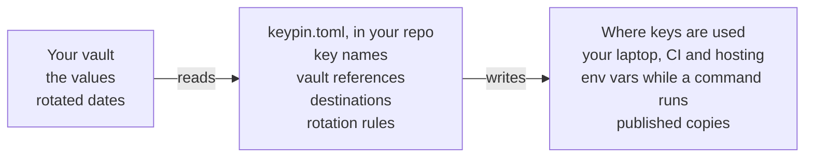

# How it works

keypin connects your vault, the places that use your keys, and the providers that issue them. It keeps only the
path between them, in `keypin.toml`.



## Your vault holds the values

Each value is kept once, in your vault. keypin reads it only while `run`, `publish` or `rotate` needs it. A
`rotated` date on the vault item tells keypin when the key is due.

## keypin.toml holds names and places

It lists the project's keys, where each one lives in your vault, and where each one goes. It holds no value, so you
commit it.

```toml
[1password]
account = "my.1password.com"

[keys.STRIPE_KEY]
rotate_every = "90d"
dev = "op://Private/billing dev stripe key/credential"

[keys.STRIPE_KEY.prod]
from = "op://Private/billing prod stripe key/credential"

[[keys.STRIPE_KEY.prod.publish]]
to = "github-actions"
repo = "me/billing"
```

Here `STRIPE_KEY` has one 1Password field for `dev` and another for `prod`, and the `prod` value is published to the
GitHub repo `me/billing`. keypin rejects a field it doesn't know and a `<...>` left in a value. Every field is in
[keypin.toml](../reference/keypin-toml.md).

## References

A reference is the address of one value in your vault, such as `op://Private/billing stripe key/credential`. In
1Password, open the field's menu and select **Copy Secret Reference**. Other vaults have their own format:
[Infisical](../integrations/vaults/infisical.md), [Bitwarden](../integrations/vaults/bitwarden.md),
[Doppler](../integrations/vaults/doppler.md), [AWS Secrets Manager](../integrations/vaults/aws-secrets-manager.md).

## Environments

Each key has one entry per environment, `dev` and `prod` by default. `keypin run` uses the first and
`keypin publish` the last; `--env <name>` picks another. Each entry can point to a different vault item, so your
laptop never needs the production value.

## How a key reaches your code

- `keypin run` starts your command with the keys as environment variables. Nothing is written to disk.
- `keypin publish` writes each value to its destinations, such as a GitHub Actions secret.
- A CI job can sign in to your vault and run `keypin run` instead. See
  [Pulling in CI](../guides/publishing.md#pulling-in-ci).

## Rotation

Give a key an `issuer`, such as Resend, Neon or OpenAI, and `keypin rotate` creates a new key at the provider,
saves it to your vault and publishes it. Its plan says whether keypin revokes the old key after a second `y`, or
leaves it for you to delete, as on a first Resend rotation. See [Rotating a key](../guides/rotating-a-key.md).

`keypin status` shows which keys are due, and [Scheduled rotation](../guides/scheduled-rotation.md) rotates them in
GitHub Actions.

## keypin asks first

`publish` and `rotate` check the account behind each login and show a plan. A first write, a changed account or a
changed vault item waits for your `y`. keypin never deletes a copy it published, and keeps no value on your machine
([Files and state](../reference/files-and-state.md)).
